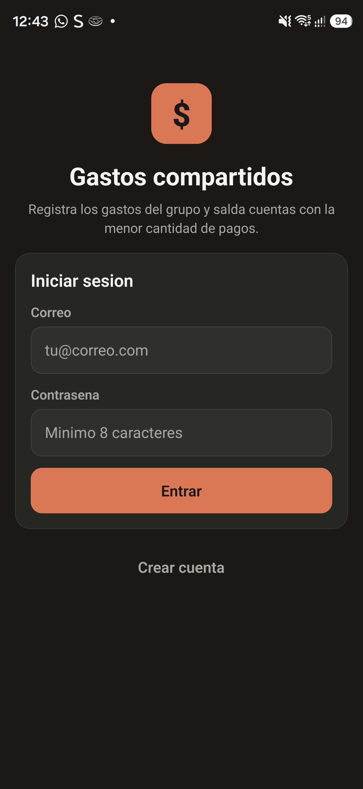
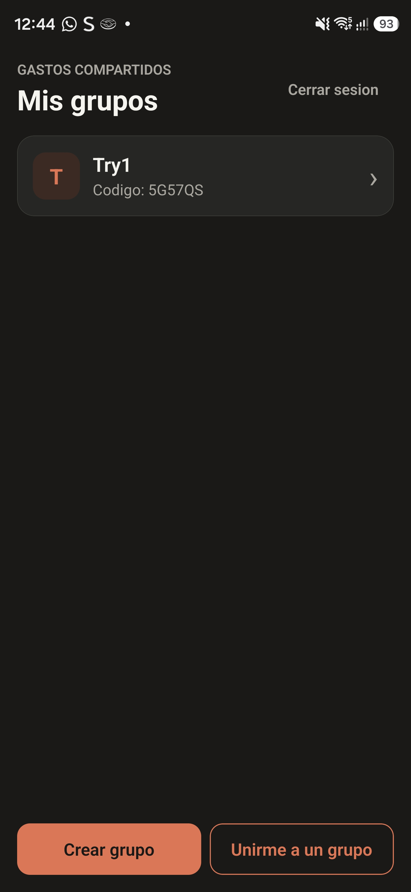
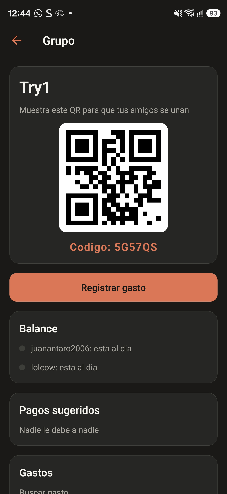
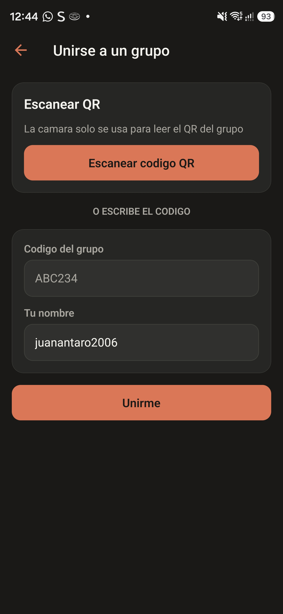
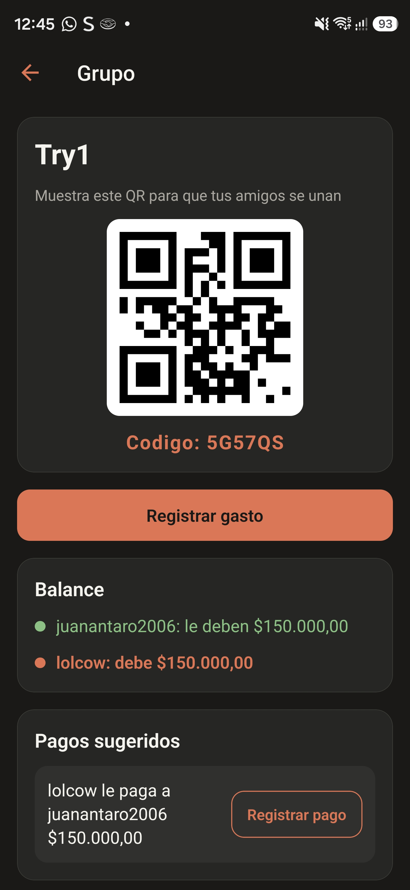
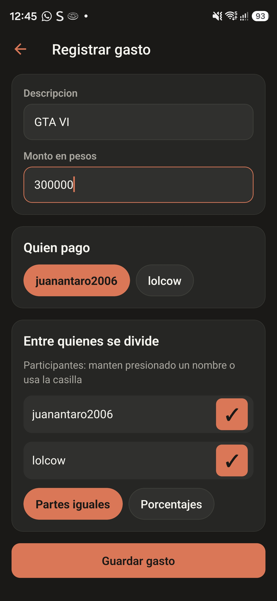
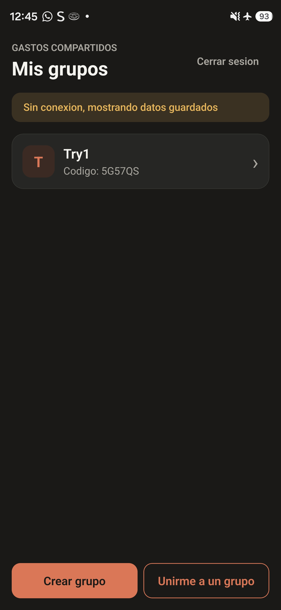
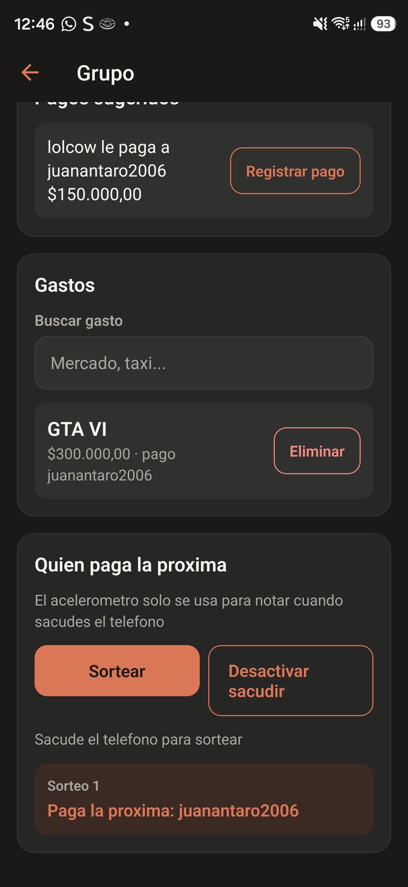

# 34-gastos-compartidos-app

App movil del proyecto 34, gastos compartidos entre amigos. Materia Desarrollo Movil, TdeA.
Un grupo de amigos registra sus gastos y la app calcula quien le debe a quien.

Hecha con Expo, React Native, TypeScript y Expo Router. La API esta en el repo `34-gastos-compartidos-api`.

## Capturas

Tomadas en un telefono Android con el APK de la build 7, contra la API desplegada.

| Iniciar sesion                                                                        | Mis grupos                                                                    | Grupo recien creado (codigo y QR)                                                          | Unirse (QR o codigo)                                                             |
| ------------------------------------------------------------------------------------- | ----------------------------------------------------------------------------- | ------------------------------------------------------------------------------------------ | -------------------------------------------------------------------------------- |
|  |  |  |  |

| Balance y pagos sugeridos                                                                  | Registrar gasto                                                                        | Sin conexion                                                                       | Gastos y sorteo por sacudida                                                                |
| ------------------------------------------------------------------------------------------ | -------------------------------------------------------------------------------------- | ---------------------------------------------------------------------------------- | ------------------------------------------------------------------------------------------- |
|  |  |  |  |

## Como instalar y correr

Hace falta Node 22.5 o mayor (las pruebas de los repositorios usan `node:sqlite`; la CI usa Node 24).

```bash
npm install
cp env.example .env   # y cambiar la URL de la API
npm start
```

Se abre con Expo Go o con un emulador. La URL de la API va en el archivo `.env` (`EXPO_PUBLIC_API_URL`).
Esa URL es publica, no es un secreto. La API publicada esta en https://34-gastos-compartidos-api.vercel.app.

## Comandos

| Comando                | Que hace                                              |
| ---------------------- | ----------------------------------------------------- |
| `npm start`            | Abre Expo                                             |
| `npm run android`      | Abre Expo en Android                                  |
| `npm run ios`          | Abre Expo en iOS                                      |
| `npm run typecheck`    | Revisa los tipos con TypeScript                       |
| `npm run lint`         | ESLint, no acepta warnings                            |
| `npm run format`       | Arregla el formato con Prettier                       |
| `npm run format:check` | Revisa el formato sin cambiar nada                    |
| `npm test`             | Pruebas con cobertura                                 |
| `npm run test:hook`    | Pruebas del hook de IA (`ia/hook/`)                   |
| `npm run check`        | Corre typecheck, lint, format:check, test y test:hook |

Si `npm run check` no pasa, el trabajo no esta terminado.

## Estructura

- `app/` pantallas y rutas
- `src/` dominio (`domain`), base de datos (`db`), repositorios, servicios, cliente de la API (`api`), sensores y componentes
- `scripts/` revision de secretos y direcciones locales
- `ia/` bitacora, retos y el hook de IA
- `tests/` pruebas
- `docs/` enunciado, reglas de negocio, contrato de la API, plan y estado

## Dependencias y por que

Las que venian con la plantilla de Expo y se dejaron:

| Paquete                                                   | Para que                            |
| --------------------------------------------------------- | ----------------------------------- |
| `expo`, `react`, `react-native`                           | Base de la app                      |
| `expo-router`, `expo-linking`, `expo-constants`           | Rutas y navegacion                  |
| `react-native-screens`, `react-native-safe-area-context`  | Las necesita la navegacion          |
| `react-native-gesture-handler`                            | Gestos, lo pide el enunciado        |
| `react-native-reanimated`, `react-native-worklets`        | Animaciones de los gestos           |
| `expo-splash-screen`, `expo-status-bar`, `expo-system-ui` | Pantalla de carga y barra de estado |
| `expo-font`                                               | Fuentes, la usa Expo                |

Las que se agregaron:

| Paquete                                       | Para que                                                                                                  |
| --------------------------------------------- | --------------------------------------------------------------------------------------------------------- |
| `jest`, `jest-expo`                           | Correr las pruebas, lo pide el enunciado                                                                  |
| `@testing-library/react-native`               | Probar pantallas y componentes, lo pide el enunciado                                                      |
| `test-renderer`                               | La exige `@testing-library/react-native` version 14                                                       |
| `@types/jest`                                 | Tipos de Jest para TypeScript                                                                             |
| `eslint`, `eslint-config-expo`                | Reglas de calidad                                                                                         |
| `prettier`                                    | Formato igual en todo el codigo                                                                           |
| `typescript`, `@types/react`                  | Tipos estrictos en todo el codigo                                                                         |
| `husky`, `lint-staged`                        | Revisar lo modificado al commitear y correr `npm run check` al hacer push                                 |
| `@types/node`                                 | Tipos de Node, para usar su SQLite en las pruebas de los repositorios                                     |
| `expo-sqlite`                                 | Base de datos local, la app funciona sin conexion                                                         |
| `expo-secure-store`                           | Guardar los tokens de sesion de forma segura                                                              |
| `expo-crypto`                                 | Generar los id (UUID) de gastos y pagos                                                                   |
| `@react-native-community/netinfo`             | Saber si hay conexion para sincronizar. No esta en la lista del enunciado, es el que usa la guia de clase |
| `expo-camera`                                 | Escanear el QR de un grupo                                                                                |
| `react-native-qrcode-svg`, `react-native-svg` | Mostrar el QR del grupo                                                                                   |
| `expo-sensors`                                | Acelerometro, sacudir para sortear                                                                        |
| `expo-haptics`                                | Vibracion al registrar un pago                                                                            |

Se quitaron de la plantilla porque no se usan: `@expo/ui`, `expo-glass-effect`, `expo-image`, `expo-symbols`,
`expo-web-browser`, `expo-device`, `react-dom` y `react-native-web`. La app es solo movil.

## IA

La configuracion de IA y sus evidencias estan en `IA.md` y en la carpeta `ia/`.

## APK

El APK se genera con EAS Build, perfil `preview` de `eas.json`, que ya trae la URL de la API y compila solo para telefonos arm64:

```bash
eas build -p android --profile preview
```

Version entregada: build 7 (versionCode 7), con el icono propio de la app. La build 6, identica salvo el icono, se probo en un telefono Android contra la API desplegada.

- Descarga directa del APK: https://expo.dev/artifacts/eas/hayJlo50A6OMidsNzP4jAeVqykssYFMc3enu_NOScuw.apk
- Pagina del build en EAS: https://expo.dev/accounts/adnsupreme/projects/34-gastos-compartidos-app/builds/c9f02f72-ff73-43d3-b78e-725b61800652

Para instalarlo hay que permitir apps de origenes desconocidos en el telefono. La API que usa es
https://34-gastos-compartidos-api.vercel.app
